# MES / APS 连续操作指南

核对日期：2026-10-16。固定版本：`a9b625b297e7797c058e40b428c24bf611750daf`。这是一份本轮真实页面走查形成的时点指南，供演示和复盘；当前产品规则仍以 Product、公开合同和服务端门禁为准。

这条主线已经从新建 MPS 走到 **2 件成品完成库存过账**。建议围绕一张工单讲清楚需求、备料、排程、执行、质量与入库，始终沿用原单据，不在各页重新创建业务对象。遇到下面注明的停点，应展示原因和交接对象。

阅读时先走第一部分的生产主线，再按需要加入交接、停机和质量异常支线。问题、优先级、后端证据和未跑范围见[复查报告](2026-10-16-mes-aps-fresh-walkthrough.md)。本指南配套 HTML 可离线打开，无需保持业务服务器或画布服务启动。

## 开始前，先准备好人和物

演示对象是 **P1 平台前滑柱总成（左），FG-QJ-P1-L，2 件**，一号工厂 `SITE-001`，工厂时区 `Asia/Shanghai`。本次实际主单为 `WO-20261016-000001`；重新演示时使用新产生的编号，不照抄旧编号提交。

分别准备计划员、物料员、操作员、质检员、完工登记/财务、接班人账号。演示停机时另用班组长账号；演示追溯时用有相应只读权限的账号。角色不能用管理员替代。操作员的工作中心范围需要覆盖本次八道工序；每次换岗位都先退出，再重新登录。

准备人员需要提前确认有效生产版本、11 行制造 BOM、工艺路线、班次日历、员工与班组关系、检验方案、成本期间和工作中心费率。原料仓有库存，只说明库存前提存在；现场仍要领料和线边收料。本轮这些基础前提通过公开接口准备，业务单据和主线动作通过真实页面产生；没有直接写库，也没有预置完工或入库结果。物理加工、实物测量和仓库实拣不在本次软件演示的证明范围。

可先打开“生产准备检查”，选择一号工厂与本次工作中心，再“重新检查”。本轮缩小到 `WC-TUB-01` 后九个基础区域就绪；选全厂时还会列出本旅程未使用的其他工作中心缺费率。这个页面不检查人员技能和每道工序的开工条件，不能把基础区域就绪当成可以直接开工。

当前已知限制：工序执行表存在明显文字重叠，放大视口也不能完全解决；工艺路线专用 SOP 在任务页未匹配成功。软件流程可继续核对，实际现场生产应先解决指导书可达性。不要用缺少 SOP 的界面宣称现场已经具备安全生产条件。

## 先把需求变成一张工单

### 1. 计划员建立并发布需求

进入 **需求与计划 → 需求与物料计划**，选择“新建 MPS”。物料选择 `FG-QJ-P1-L`，工厂选择一号工厂，单位选“件”，数量填 `2`，计划日期选择本次业务日，保存。

在该行先“评审”，再“发布”。继续前确认状态是已发布，产品、数量、工厂和日期都正确。本轮 MPS 为 `01a144d0-7959-7020-a3a5-6975b1931027`。

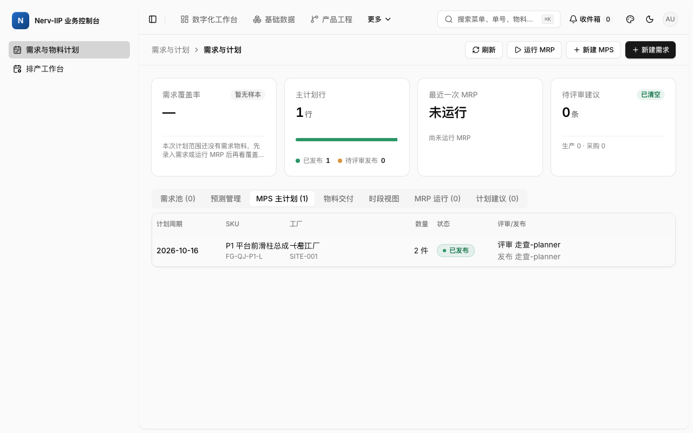

### 2. 计划员运行 MRP，接受成品生产建议

点击“运行 MRP”，确认计算窗口，等待运行完成，再进入“计划建议”。本轮日期窗口为 10 月 16 日至 11 月 15 日，产生 13 条建议：2 条生产建议、11 条采购建议。

找到 `FG-QJ-P1-L` 的生产建议，核对数量、生产版本和来源需求后点击“接受”。等待承接完成，记录返回的工单号。本轮得到 `WO-20261016-000001`，包含 OP10 至 OP80 共八道工序。不要再次用“创建急单”复制这张单。

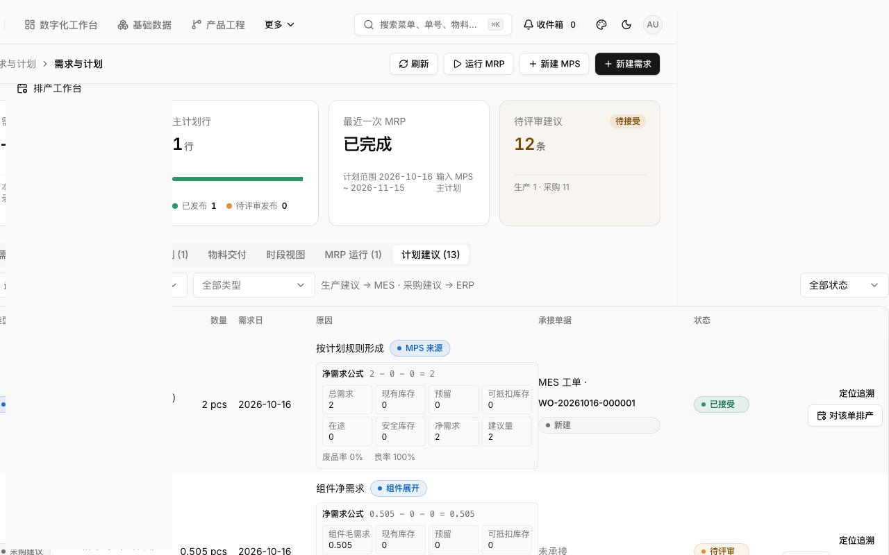

若运行失败，留在原运行查看错误；若接受结果不明，先查原建议的下游工单，不连续点击生成多单。本次没有连续执行 11 条采购建议和 ERP/WMS 采购收货链，库存准备由前置准备提供。

## 让物料和工单先准备就绪

### 3. 物料员按同一工单领料、收料

进入 **制造执行 → 工单与派工**，打开刚产生的主工单。在“用料齐套”逐行核对需求量，点击“发起领料”，确认后，在“领料与收料”对对应申请执行“线边收料”。第二页还有第 11 行物料，不能只完成第一页。

不要把成品数量 `2` 填到每一行用料上。本轮每行应领量如下，重新演示须以新工单实际需求为准：

| 物料 | 数量 | 单位 |
| --- | ---: | --- |
| PK-BOX-01 | 0.505 | pcs |
| PK-LBL-03 | 2.04 | pcs |
| RM-ACC-01 | 4.02 | pcs |
| RM-ACC-04 | 2.01 | pcs |
| RM-ACC-07 | 8.08 | pcs |
| RM-OIL-01 | 1.326 | l |
| RM-SEL-01 | 4.04 | pcs |
| RM-SPR-05 | 2.01 | pcs |
| SF-ROD-01 | 2 | pcs |
| SF-TUB-01 | 2 | pcs |
| SF-VLV-01 | 2 | pcs |

本轮 11 张申请 `MIR-20261016-000001` 至 `000011` 全部收齐，工单齐套结果为 Ready、无阻塞。确认前一次收料的数量和状态已经回写，再处理下一项。收到“等待过账或更新齐套”提示时先等待、刷新原单，不重复收料。

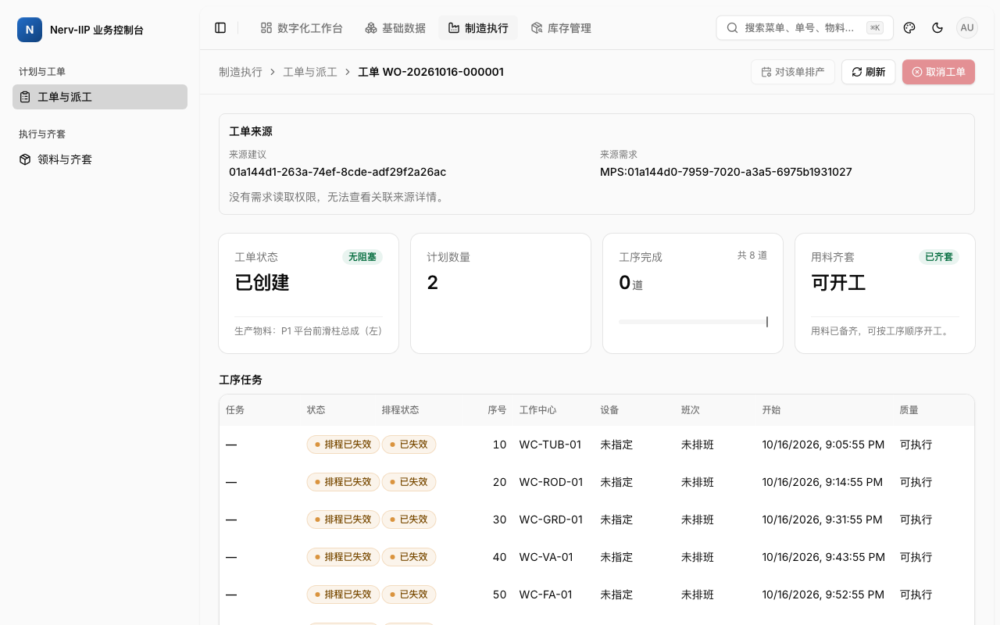

本轮未启用 WMS 演示工作器，申请没有 WMS 出库单号；“已收料”不能被讲成“已证明仓库实拣、出库和实物移交”。正式仓储演示应另接真实仓储岗位路径。

### 4. 计划员下达工单

回到工单列表，在原单操作菜单中选择“下达工单”，阅读确认内容，勾选确认项，再确认下达。确认该单已下达，仍是同一产品、2 件、八道工序。

如果提示缺料或质量等阻塞，按提示回对应岗位处理，不能用排程发布替代工单下达。计划员缺物料读取权限时，详情页当前可能显示“齐套更新失败”；这是本轮发现的权限反馈问题，应由物料岗核对真实齐套，不反复点击无法恢复的按钮。

### 5. 计划员最后生成并发布排程

进入 **需求与计划 → 排产工作台**，只加入本次工单，点击“生成首版”。确认八道工序齐全，查看资源、时间、前后依赖和风险。甘特图使用工厂时区，未知设备会提示人工确认，缺料警告也不等于现场已允许开工。

如需调整，回草案工作区编辑，锁定修改，再“锁定重预览”，比较变更后点击“发布新版”，在确认框里再次“确认发布”。生成、保存、预览都不等于发布。发布后到现场刷新，确认任务已排程。

推荐把“线边齐套、工单下达”放在正式发布之前。本轮先排程再备料时，物料变化和工单下达都使旧方案失效，造成重复发布。若当前页面恢复了别的工单草稿，先核对草稿编号和目标工单，再明确清空当前草稿或切换方案，不能看到已选 1 单就直接发布。

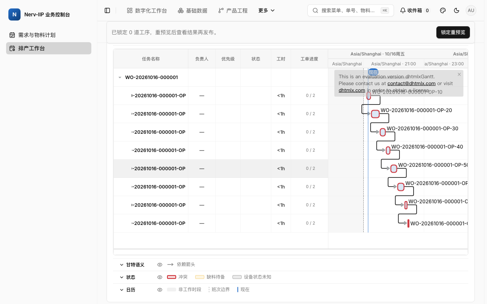

## 操作员沿工序执行，质量员在原工序接手

### 6. 派工并开工

操作员进入 **制造执行 → 工序执行**，在“作业范围”选择本工序工作中心，核对工单号和工序号。第一道行菜单选择“派工”，选择实际操作员、设备和班次，确认后再“开工”。本轮第一道选择了真实在岗的走查操作员和早班。

正常顺序如下，后一道不能凭排程颜色跳过前一道：

| 顺序 | 工序 | 工作中心 |
| ---: | --- | --- |
| 10 | 下料 | WC-TUB-01 |
| 20 | CNC 精车 | WC-ROD-01 |
| 30 | 精磨 | WC-GRD-01 |
| 40 | 阀系预装 | WC-VA-01 |
| 50 | 总装 | WC-FA-01 |
| 60 | 电泳涂装 | WC-CT-01 |
| 70 | 性能终检 | WC-TS-01 |
| 80 | 包装 | WC-PK-01 |

当前后续工序在未显式派工时也允许开工。本轮 OP20–80 的报工有真实登录主体，但没有逐道补派工，所以部分行显示“完工未记录工人”。完整人员履历演示应逐道派工，不能把报工人和派工对象混为一谈；本轮没有把这种未派工路径算作完整人员履历通过。

### 7. 报工，确认本工序完成后再换工作中心

开工后，该行出现“报工”按钮。点击后核对只读的工单、工序与工作中心，录入本次真实数量。本轮软件流程每道合格数量 `2`、报废 `0`、返修 `0`，勾选“本工序已完成”后提交。

等待弹窗关闭和任务状态变成已完工，再换下一个工作中心。处理中或结果不明时查原报工号，不重复提交。全部工序的合格量相加是工序产出，不是成品入库件数；本轮八次报工的日报累计合格量 16，最终成品是 2 件。

需要暂停时，在当前任务菜单“暂停”；确认已暂停后“恢复加工”，再报工。本轮 OP20 的暂停与恢复均已验证。标准工时不能冒充实际加工时长，本次短时软件操作自动形成的实绩不代表物理生产效率。

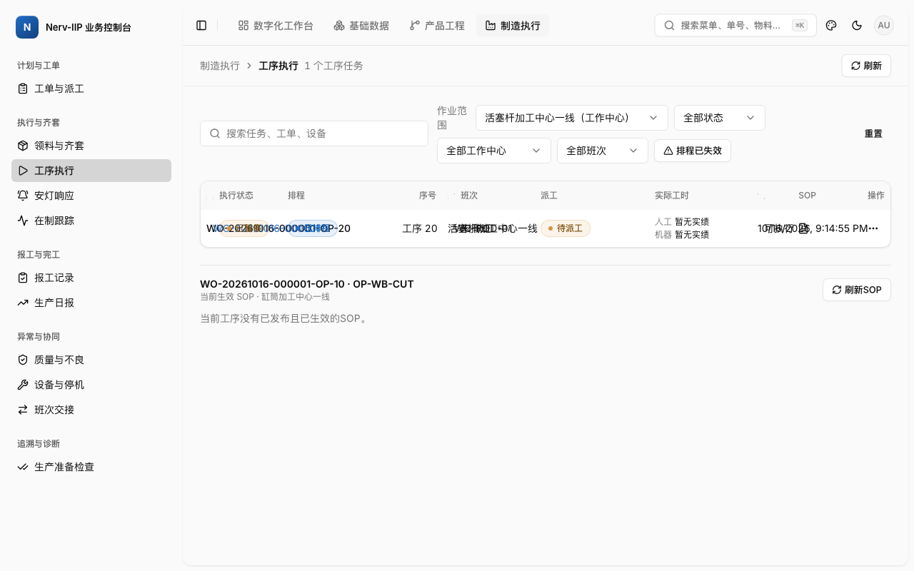

### 8. 质量员从 OP70 呼叫检验

在第 70 道行菜单选择“呼叫质检”，进入 **质量 → 检验任务与记录**。首先核对带出的 SKU 是 `FG-QJ-P1-L`，来源是原工单与 OP70，再选择适用检验方案，填写检验数量及每项必填特性，选择结论，提交检验记录。

本轮使用公开准备的方案 `IP-A1016-OP70`，数量 2，属性特性 `visual-a1016`，记录明确写“软件流程核验通过（无实物测量）”。成功记录为 `01a144e1-6b7c-7d19-94a3-397c03368115`。不能把软件流程结论用于说明实物质量合格。

通过“返回工单”回到原单，确认来源工序标记仍指向 OP70。

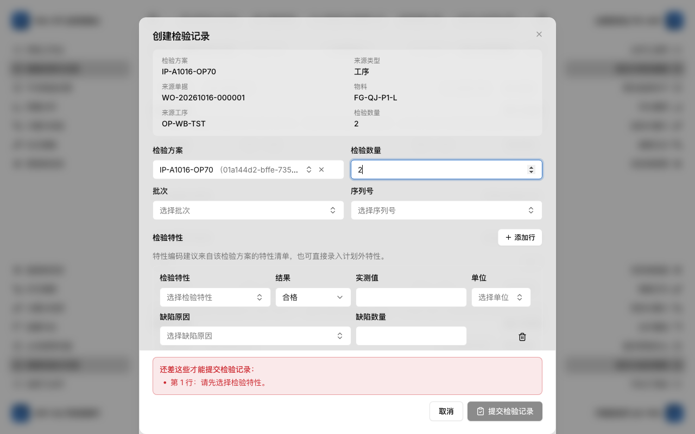

### 9. 质量放行后，让计划员接回排程

本轮质量通过触发 `qualityReleased`，旧排程失效，尚未开工的 OP80 变成待重排。操作员在此停止尝试开工，把原工单号交给计划员。

计划员打开失效方案，点击“锁定重预览”，核对剩余任务与已完成事实，再发布新方案。等待异步回流，操作员刷新后确认 OP80 已排程，再开工、报工 2 件并完成。不要在此另建工单或修改后台状态。

这条恢复路径本轮已经走通，但它仍增加岗位往返；质量放行后的自动接续策略属于待讨论的产品改进。

## 用库存终态结束主线

### 10. 完工登记人员沿原工单登记入库

八道工序都完成后，打开原工单，点击“完工入库”。页面会携带工单、SKU 和建议数量，自动选择唯一可用产出批次。本轮末道报工自动生成 `LOT-PRPT-20261016-000008`，不需要手工编造批次。

核对剩余可入库量 2、数量 2，单位选择“件（pcs）”，确认登记。成功后记住入库单号。本轮为 `FGR-20261016-000001`。已登记、等待成本、待入库和已入库是不同阶段；列表暂时显示等待时先刷新原登记，不再创建第二张。

### 11. 打开“库存来源”，确认真的入库

列表变成“已入库”后点击“库存来源”，核对原入库单、工单、产出批次、数量和库位。本轮实际回读为：已过账 2、剩余 0，成品库 `loc-fg-01`，该批次库存 2、预留 0、可用 2。

这才是本次软件主线的入库终点。单位成本 `3.728364` 已回传，但不能据此宣称最终成本核对无差异。

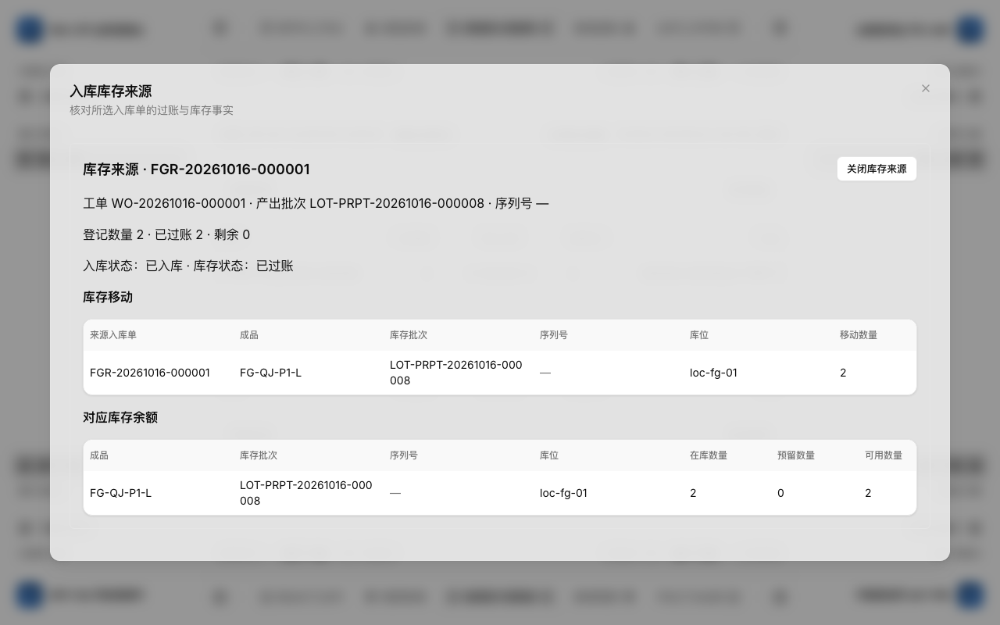

### 12. 财务核对成本，追溯人员核对来源

财务进入 **经营管理 → 财务 → 工单成本差异**，选择原工单，点击“查询工单”。核对实绩人工、机器费用和资本化差额。本轮实际人工 CNY 6.329603、累计成本 CNY 7.595523、已资本化 CNY 7.456728、差额 CNY 0.138795；标准人工差异显示“报工数值精度超出核算范围”。保持这个结果，不把空白补成零，也不为消除差额重复入库。

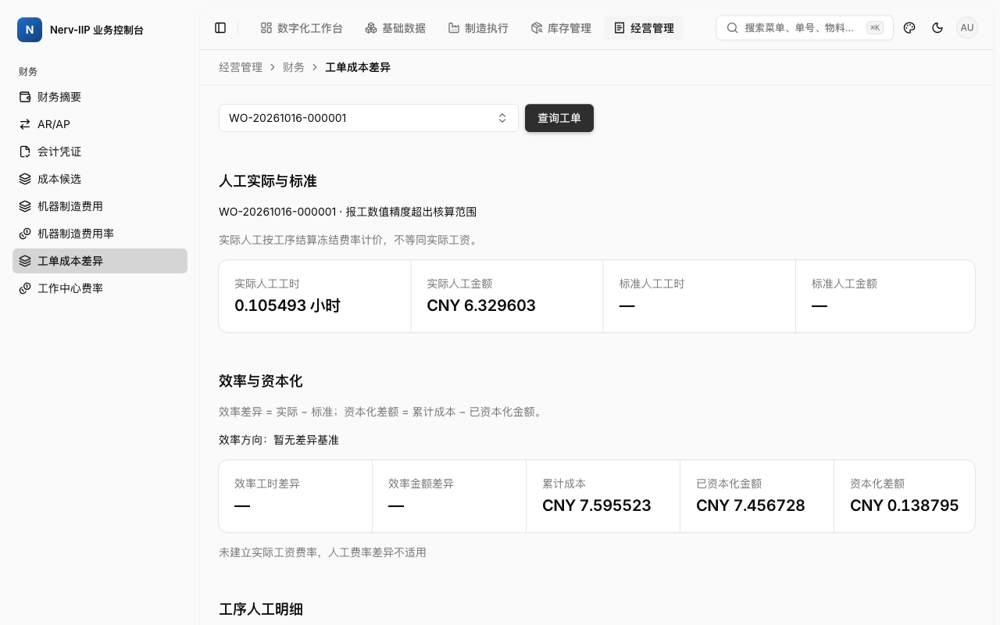

追溯人员进入 **制造执行 → 追溯查询**，按原工单查询。本轮有 29 个节点、35 条关系。点击 OP 节点可回工单并定位来源工序；点击“报工 · PRPT…”可打开对应报工详情，再返回追溯。整批入库后，当前批次选择器会错误显示没有产出批次，此时先用工单查询和入库来源核对，不能宣称批次选择路径已通过。

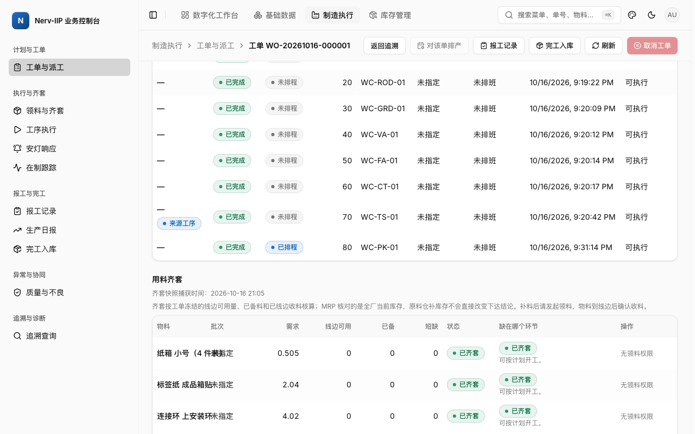

## 三条可选支线，各自有明确终点

### 跨班：先交班，再由另一人接班

交班人进入“班次交接”，点击“新建交接”，选择实际班次、班组、工作中心和工单，添加在制数量和未完进度，再创建交接。接班人重新登录，在对应交接单的操作菜单选择“接班”，核对内容后确认。

本轮 `SHO-20261016-000001` 从 Open 变为 Accepted，交接与接班为不同主体，保留 1 条在制、1 条未完工单。本次是在同一早班内验证软件交接动作，没有证明跨午夜的实物盘点。界面交接单号显示“—”，应同时核对班组、时间和原工单，后续应修复单号展示。

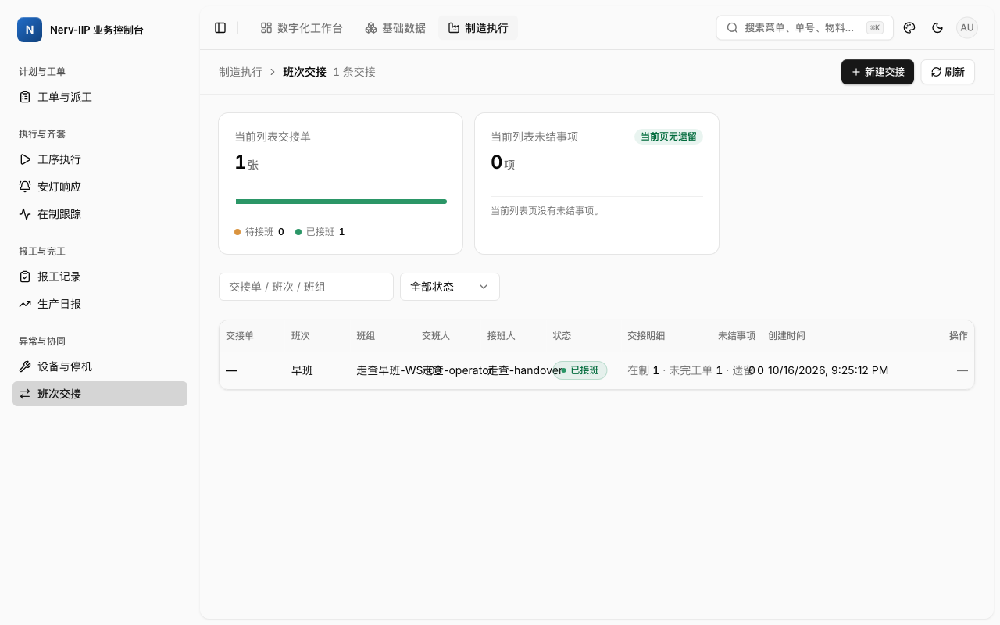

### 停机：使用班组长角色，登记后沿原事件恢复

按[停机班组长账号准备](../../runbooks/mes-downtime-team-leader.md)准备最小六权限账号、员工/班组与实际工作中心范围。从工单/工序进入“设备与停机”，点击“登记停机”，确认带出的真实设备，选原因与开始时间，确认登记。

本轮登记了 `DOWNTIME-20261016-000001`，计划保养，关联主单 OP10。页面打开时间的默认查询截止点导致新记录被筛掉，普通“刷新”仍为 0；先整页重载，或重新选择覆盖当天的日期范围，再核对原事件，禁止因找不到就重登。

在原事件点击“恢复”，阅读确认框，再“确认恢复”。本轮真实读回 Recovered，并可返回原工单、定位 OP10。该事件登记在主生产完成后，证明登记/恢复/来源接力，没有证明停机期间对在制工序开工拦截的全部分支。

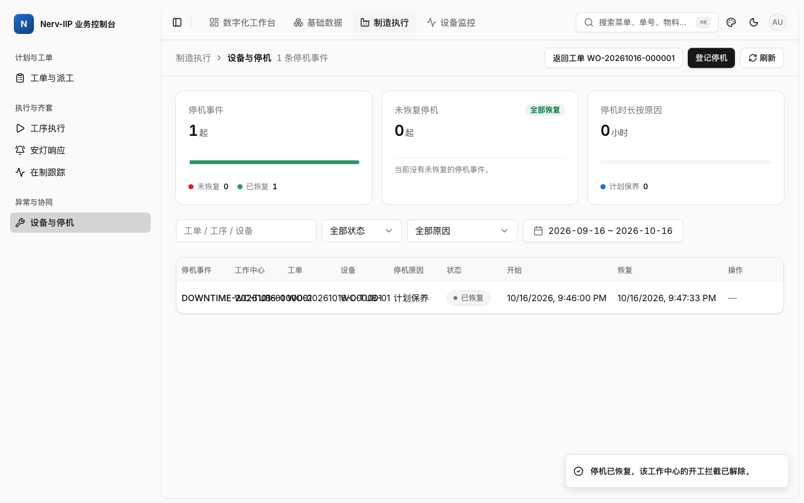

### 质量异常：缺陷会自动生成 NCR，处置目前有停点

质量员进入“质量与不良”，点击“登记缺陷”，从授权范围选择真实工单及可选工序，选缺陷码与数量，确认登记。等待关联生成后刷新原记录，再进入对应 NCR，不能为了等待而重复登记缺陷。

本轮独立急单 `WO-20261016-000002`、OP10、`SF-ROD-01` 登记尺寸超差 1，形成 `DEF-20261016-000001`，自动生成产品身份正确的 NCR。来源工序链接能返回原工单。

在 NCR 操作菜单“打开处置”，选择业务实际需要的处置。返工、报废等重大处置需要 MRB 和批准的审批链；“全检挑选”不需要中央审批，但仍需要处置证据附件。当前页面只让人填写附件文件 ID，没有就地上传入口，本轮因此停止，没有提交虚构附件、没有关闭 NCR，也没有把它算作返工或报废闭环通过。

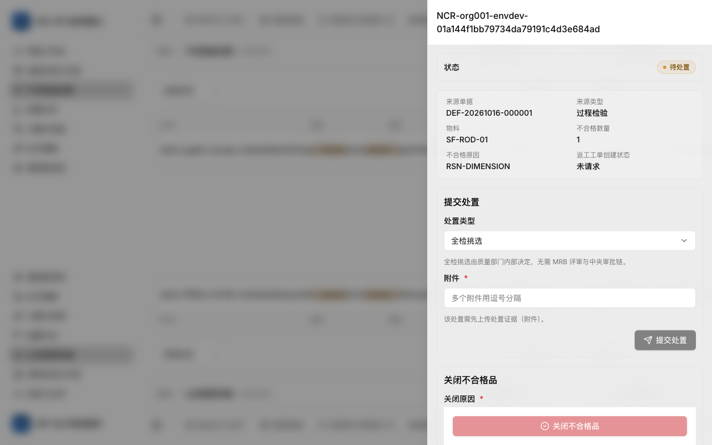

## 演示被打断时，照这个顺序处理

| 看到什么 | 下一步 | 继续前的确认 |
| --- | --- | --- |
| 范围读取失败，尚未读取任务 | 恢复连接后点“刷新”或“重新加载” | 授权工作中心与原任务重新出现；本轮已用一次原生 fetch 中断验证 |
| 任务待重排 / 排程已失效 | 将原单交计划员重预览、发布；现场刷新 | 同一任务变成已排程，不能另建任务 |
| 收料处理中 | 查原 MIR、等待齐套更新 | 已收数量和 Ready 一致，不重复收料 |
| 缺权限但提示重新加载 | 核对岗位权限，交给有权限岗位 | 重试不能增加权限，不临时改成管理员 |
| 入库待成本 / 待过账 | 保留原 FGR，刷新并核对库存来源 | Posted、移动数量、余额一致；故障重放本轮未重演 |
| NCR 要求附件 / 审批 | 准备真实证据及授权审批岗位，当前上传缺口先停止 | 不填虚构 ID，不绕过批准条件 |
| 停机刚登记却显示没有事件 | 重载页面或重选当天范围，查原事件 | 原 DOWNTIME 出现后再恢复，不重复登记 |

## 本轮没有证明的事情

采购收货与 WMS 实拣、实物加工/测量、打印机与扫码硬件、PDA 真机、完整返工与报废库存处置、MRB/中央审批全链、成本缺率/停服后的事件重放、所有越权组合、大数据性能、跨工厂时区编辑和跨午夜班次，本轮均未完整重跑。已有任务的验收仍是原固定版本证据，不升级为本版本新通过。

本轮也没有重新启动旧实时 issue 画布。离线指南的流程结果和关联问题只代表上述核对时点，不伪装成 GitHub 实时状态。#4272 的原结项状态保持不变，新发现应独立核范围并检查复用票后再决定处理。
