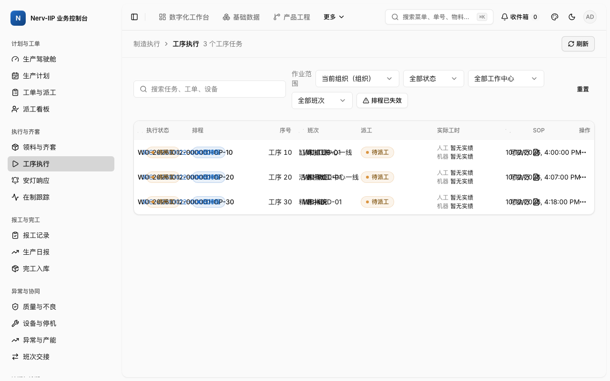

# APS 发布后 MES 作业范围与导航调查（2026-10-12）

## 结论与范围

[#4283](https://github.com/Mang-X/Nerv-IIP/issues/4283) 的一日时间盒调查完成了同一真实隔离会话内连续五轮「APS 发布 → MES 导航 → 工序执行」。五轮均未复现 U08 的「无可选授权范围 / 0 任务，整页重载后恢复」。**历史现象仍成立于原走查记录，根因仍未验证，本报告不证明缺陷已修复。**

权威范围为 [#4272 正式 spec r1](https://github.com/Mang-X/Nerv-IIP/issues/4272)、[计划索引](https://github.com/Mang-X/Nerv-IIP/issues/4272#issuecomment-6096126941)和 [T11](https://github.com/Mang-X/Nerv-IIP/issues/4272#issuecomment-6096124929)。2026-10-12 用户明确授权本张 spike 调查，覆盖票面历史「仅发布未授权实施」限制；生产修复与父任务扩展仍需另行批准。

重新定级结论：U08 的生产修复仍为 **scope:spike / ?**，没有足够依据直接升级为权限数据修复。另有一个可验证的 **M 级前端恢复行为候选**，见下文；尚未开票或实施。没有修改生产代码、权限目录、测试基建或 [#4256](https://github.com/Mang-X/Nerv-IIP/issues/4256) 的工单来源授权并集范围。

## 固定基线与真实环境

- 代码 SHA：`94ca021da4bd7dff5d0303c180763092c4409d92`，从当时最新 `origin/main` 建树。
- 工作树：`/Users/mang/.t3/worktrees/Nerv-IIP/issue-4283-spike`；分支：`spike/4283-aps-mes-scope`。建树前确认目标不存在，票号及分支搜索未发现对应 PR；数字搜索命中的 #1538 是测试数 4,283，未复用。
- 原时间盒从北京时间 08:28 开始，真实取证与自有栈清理在 09:18 前完成，恢复后没有重置时间盒。
- 两个先后会话：`nerv-4283-a12b01`、`nerv-4283-a12b02`，均使用同一代码 SHA、真实 PostgreSQL / Redis 和正式服务。启动采用现有 `issue-1912-real-machine-walkthrough` scenario，基础主数据来自该本地 seed。
- 正式连续轮次属于第二个会话：Business Console `http://localhost:50453`、BusinessGateway `http://localhost:50455`、PlatformGateway `http://localhost:50436`。AppHost PID `49708`，记录 PID 与自有容器后，页面及 Gateway health 均实际返回 200。
- 登录身份是种子管理员 `user-admin` / `role-platform-admin`，组织 `org-001`、环境 `env-dev`，实际 scope 为 `organization/org-001`。本票没有执行最小权限角色或生产环境验收。

实际启动入口，两次只改变 session ID：

```sh
NERV_IIP_FULLSTACK_MAX_SESSIONS=2 pwsh -NoProfile -File nerv.ps1 fullstack start \
  -Scenario issue-1912-real-machine-walkthrough -SessionId nerv-4283-a12b02
```

## 业务准备与采证有效性

在真实页面「工单与派工 → 创建急单」选择 `SF-ROD-01`、当前有效生产版本、数量 1、`WC-ROD-01` 与次日交期，得到 `WO-20261012-000001`。正式读面返回三个工序 `WO-20261012-000001-OP-10/20/30`，工序码 `OP-WB-CUT/CNC/GRD`。工单、首版、重预览和发布均由页面提交，没有使用 API fixture 桥接业务写入。没有补料、派工、开工、报工或执行父规格完整制造闭环。

原栈基线在创建工单之前，实际 scope 请求返回授权组织范围，任务请求返回 `success=true, total=0, items=[]`；这是正常空列表。创建后读回 `total=3`。该对照用于区分数据前提不足与读取失败，不能代替 U08 的失败网络。

采集器只保存选定路径的 query、HTTP 状态、correlation、授权范围、任务身份及排程时间等字段；没有保存 Authorization header、口令或 token。客户端只读取 Vue 已有状态及页面文本，记录 scope ready/pending/unavailable、错误、任务数与筛选身份。

原栈第二轮的辅助采集器在 fetch 完成后克隆已消费的 Request，干扰了前端成功返回处理；该轮全部排除于产品结论。服务器已经接受的首版 / 修订请求仍留在 `pre-reload-diagnostic.json`，不把它们计成有效页面发布轮次。

恢复后的 `recorder-v3.js` 直接返回原生 fetch Promise，并异步读取 Response 副本，不读取请求正文。真实 GET 对照：直接与采集器请求均 200、授权范围一致，`sameNativePromise=true`、应用响应正文可读取；真实页面急单 POST 200，前端随后正常刷新。采样以 250ms 为间隔，每次最多 20 秒；这不是对任意时序或更短瞬态的完备证明。

## 连续五轮结果

首轮由首版发布；后四轮从页面「锁定重预览」生成新版本后确认发布。每轮沿「更多 → 制造执行 → 工序执行」导航，先记录进入状态，再等待真实行显示。快速切换保留了查询缓存行为；需要权威新读数时使用页面现有刷新，刷新前状态另行保存。

| 轮次 | 发布方案 | 发布时间（北京时间） | 最终任务数 | 三个工序的 scheduledAtUtc |
| --- | --- | --- | --- | --- |
| 1 | `plan-01a12da81fb7707a9f29f2a1a7092541` | 09:09:34 | 3 | `2026-10-12T01:09:34.642509+00:00` |
| 2 | `plan-01a12da98d5c7a7ea46f3efd8de71bc8` | 09:10:49 | 3 | `2026-10-12T01:10:50.149614+00:00` |
| 3 | `plan-01a12da99cab74349935925457e752c0` | 09:10:53 | 3 | `2026-10-12T01:10:53.842831+00:00` |
| 4 | `plan-01a12daa52d17983b8b7b834ea92923c` | 09:11:41 | 3 | `2026-10-12T01:11:41.489303+00:00` |
| 5 | `plan-01a12daa72727c42b42de7d8837d4613` | 09:11:48 | 3 | `2026-10-12T01:11:48.527816+00:00` |

五个 release 均 HTTP 200、`success=true`、`status=released`。每轮最终工序读取也为 HTTP 200、`success=true, total=3`，三个强工序 ID 不变，排程时间读回对应本轮发布。没有通过截图或发布 toast 单独推定 MES 终态。

- 五轮稳定客户端状态均为 `scopeReady=true, scopeUnavailable=false`、`organization:org-001`、一个授权范围，任务错误为空、最终 pending=false。
- 五轮共捕获 26 个 work-context 网络请求，全部 HTTP 200、授权范围为当前组织。第三轮没有新的 `operations.read/manage` 网络请求，使用此前 query cache；该轮其它三种权限的 scope 请求实际执行，工序客户端选择保持就绪，页内刷新后任务发生真实读取。不能把缓存命中记成该权限的新网络请求。
- 首轮刚导航时已经读到三个任务，但 `scheduledAtUtc=null`；后续页内刷新读到本轮排程。这个异步传播窗口没有丢失范围，也没有把任务读成空列表。
- 第三轮快切首先复用既有三个任务，再刷新取得本轮排程；第四、五轮也保留刷新前后读数。正常刷新是用于取得新事实，不是本次 U08 的故障恢复。
- 浏览器捕获的 `error` / `unhandledrejection` 为空。另有一个离开 APS 时的方案详情 GET `AbortError`，发生在旧页面查询取消，未落到 scope 或任务读取，不作为 U08。



截图证明可用范围和任务计数；表格部分列在此视口重叠，字段与排程结论以保存的客户端状态、响应投影和关联日志核对。本票没有处理布局问题。

## 关联日志

scope 请求的 `X-Correlation-Id` 全部在 BusinessGateway 日志找到对应记录。五轮 release 与最终任务读取还通过同一 TraceId 对上 Scheduling 或 MES 进程日志：

| 轮次 | release correlation | 最终任务读取 correlation |
| --- | --- | --- |
| 1 | `5f681fa7927c4e21b877d0f91c4e17ad` | `987ad1a2bf2a40579b0f652f8338d834` |
| 2 | `2c7df35fb85745358d028ee53ba045ca` | `3e96e35b048444b7b38bdec0ce36bd67` |
| 3 | `25a07863f54447e29b44e9871e0afe7a` | `c1de11c855c54150bcb074ed56166a9f` |
| 4 | `1ff82e7754c947ed81a5fa68c6a96c43` | `5a624038adf04e308b2c48ce6b9e6d75` |
| 5 | `0475b6646a6c4a4180fa0dde4b3af1c9` | `941c80c9bad7456db344fd7cbb29744e` |

例如第五轮 release 的 TraceId 为 `aab2c5562437d0bb9353491b5e03f833`，Gateway 13 条、Scheduling 12 条关联记录；任务读取为 `31f12f363550a9e15373ec9bd34a30dc`，Gateway 15 条、MES 14 条。其它轮次的完整配对见 `correlation-matrix.json`，scope 配对见 `scope-log-matrix.json`。

日志通过现有 `nerv.ps1 fullstack logs` 和 `Invoke-AspireOutput` / `Protect-NervFullStackDiagnosticText` 留存。默认脱敏会使部分 JSON 日志外壳不可解析，另从真实日志内存结果生成只含 timestamp/level/trace/span 与闭合属性集合的可解析关联投影。Scheduling 中 35 条非 JSON 文本不进入该投影，计数明确保留；没有修改日志 producer 或放宽脱敏。

浏览器响应未携带 traceparent，未采集独立 OpenTelemetry span export 或完整 CAP message provenance。上述日志关联与 MES 权威时间读回足以证明本次页面发布结果；不宣称正式 FullChain / Redis-CAP lane 或完整端到端 trace 已通过。

## 恢复与中断

U08 的稳定复现条件仍未知，本次没有真实故障可用于验证「失败 → 恢复」。最终整页重载对照仍得到相同组织范围和三个任务，见 `reload-control.json`；它证明正常场景重载可用，不能证明历史故障的恢复机制。

旧栈重载后曾观察到「正在核验当前作业范围… / 0 个工序任务」，范围控件仍为当前组织；随后请求成功并恢复三个任务。恢复记录中的 scope 请求耗时约 0.08–1.34 秒，属于成功读取中的暂态；没有「授权范围为空」或失败响应。旧栈记录单独保存，不混入连续五轮统计。

09:03 恢复检查发现旧 AppHost / CLI / guardian 已退出，页面与 Gateway 连接失败，Docker daemon 不可达，虽然 manifest 仍是 Running。Docker 恢复可访问后，经受治理 stop 精确清理旧自有会话，并用同一工作树 / SHA 启动第二会话。新 start 的既有 admission/GC 自动回收了过期、已失去进程的 `nerv-4330-a10260` 会话，实际副作用保存在 `restart.log`；本席位没有手动停止其它会话或批量 prune。

## 有界原因判断与最小建议

实际证据支持三个不同状态：创建前的真实空列表；页面切换期间的加载 / 查询缓存；发布后异步排程传播。没有观察到 scope 服务拒绝、授权范围返回空、任务读取失败或客户端丢失已授权选择，不能将任一种正常状态升级为 U08 的根因。

代码提供一个待验证的窄恢复候选：

1. `useMesPrincipalWorkScope` 已分别表达加载、错误、真实无授权范围与已选范围；`knownAuthorizedScopes` 由成功响应维护。scope 未 ready 时，任务 query 不启用，scope 绑定响应会清空，因此页面的 0 计数不能单独证明后端空列表。
2. 工序页刷新按钮 / retry 都调用 `refreshOperationTasks`；该函数在 scope 未 ready 时直接 `Promise.resolve()`，不会调用现成的 `refreshScope`。`MesWorkScopeSelect` 只按可选范围禁用选择器，没有提供重新读取 scope 的动作。
3. 因而，**若后续捕获首次 work-context 读取失败且 scopeReady=false**，最小 M 级候选是让该失败状态的明确恢复动作调用既有 scope refetch，在范围就绪后重读任务，并区分「读取失败」与「授权列表确实为空」。不扩展 #4256 权限列表，不改 IAM / Gateway 授权，不加隐式重试、恢复中心或新框架。

源代码坐标绑定本报告代码 SHA：[scope 状态](https://github.com/Mang-X/Nerv-IIP/blob/94ca021da4bd7dff5d0303c180763092c4409d92/frontend/apps/business-console/src/composables/useBusinessMes.ts#L343)、[scope 绑定响应](https://github.com/Mang-X/Nerv-IIP/blob/94ca021da4bd7dff5d0303c180763092c4409d92/frontend/apps/business-console/src/composables/useScopeBoundListResponse.ts#L13)、[任务刷新 gate](https://github.com/Mang-X/Nerv-IIP/blob/94ca021da4bd7dff5d0303c180763092c4409d92/frontend/apps/business-console/src/composables/useBusinessMes.ts#L2226)、[范围选择器](https://github.com/Mang-X/Nerv-IIP/blob/94ca021da4bd7dff5d0303c180763092c4409d92/frontend/apps/business-console/src/components/mes/MesWorkScopeSelect.vue#L28)。这部分是静态候选解释，没有用 fixture 或静态分析冒充运行时根因。

后续建议先审阅本次调查结果；若批准上述恢复切片，再以真实失败 scope 请求与 Gateway 日志建立失败输入，验收「失败不显示成真实空态、用户重读成功恢复原任务」。当前没有可直接批准的权限数据修复，也没有新开重复票。

## 证据、结项与未验证项

运行证据目录：`/Users/mang/.t3/worktrees/Nerv-IIP/evidence/issue-4283-spike/`，40 个证据文件及一份 `SHA256SUMS`。该 manifest 的 SHA256 为 `23b24234f4ea793268903113ebeafff0b7092ef5a46e899d36c5474c53c50fad`。

主要产物：`continuous-1.json` 至 `continuous-5.json`、`continuous-complete.json` / `continuous-metadata.json`、`correlation-matrix.json` / `scope-log-matrix.json`、三个 `*-correlations.json` 与脱敏服务日志、`reload-control.json`、两份恢复旧执行记录、`privacy-check.json` 和清理回执。运行日志与采集器不入库，仓库只保留本报告、入口链接与一张截图。

本票三个调查条件均有对应产物：连续真实轮次及 scope / 客户端 / 错误 / 任务 / 日志；恢复方式与未复现判断、重新定级和最小建议；一日时间盒且无生产修复 / 权限扩张。调查可进入独立审核结项，Issue 暂不自行关闭，报告 PR 也不自行审核或在独立审核前合并。

未验证：原走查固定版本 `f7573754ed98bdb0583e8465057de625b535ca49` 的原四任务组合、稳定触发条件、真实 scope 读取失败后的恢复、最小权限角色、父 #4272 组合验收、PDA/物理设备、完整制造终局、正式 provider / Redis-CAP / FullChain 测试、PR CI 与 main CI。文档提交门禁绑定实际报告 head，由 PR 证据单独登记；本报告不替代这些证据。

最终清理：管理员会话实际返回 `revoked`，关闭自有 T3 tab；两个会话的 stop 均 exit 0，分别输出 `state=Stopped remaining=0`。回读两个 manifest 为 Stopped，自有容器数 0，自有栈 / 辅助进程数 0，临时口令桥接和采集辅助脚本已移除；工作树与证据保留等待独立审核。
