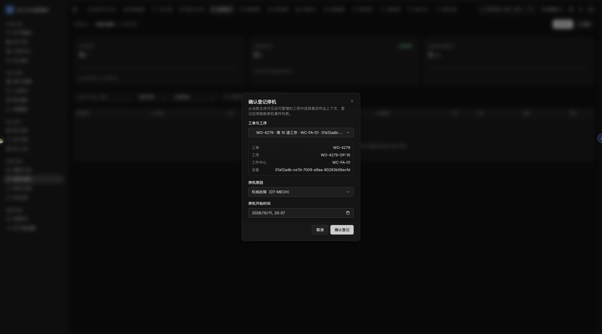
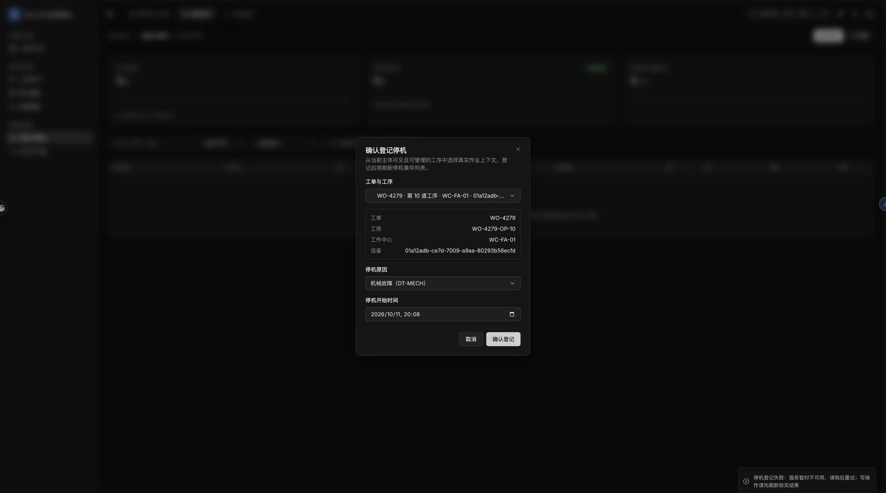
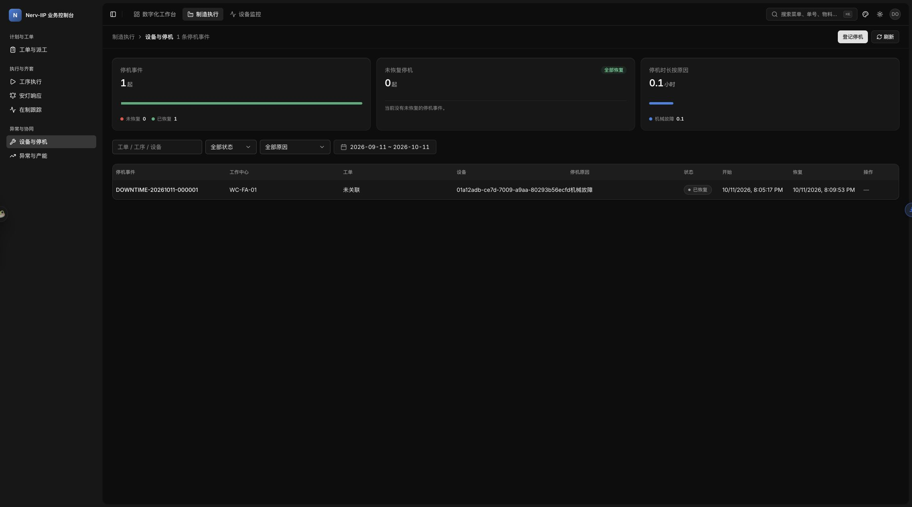

# 停机登记范围拒绝与恢复调查（2026-10-11）

## 基线与授权

本报告冻结 [#4279](https://github.com/Mang-X/Nerv-IIP/issues/4279) 的一日时间盒调查。权威为 [#4272 已批准规格](https://github.com/Mang-X/Nerv-IIP/issues/4272)、[计划索引](https://github.com/Mang-X/Nerv-IIP/issues/4272#issuecomment-6096126941)与 [T07](https://github.com/Mang-X/Nerv-IIP/issues/4272#issuecomment-6096123818)。只调查停机拒绝与恢复切片，生产代码未修改。

- 真实运行 SHA：`bac6b1bfcc9afc95b079db4acb507d73dfba55c0`，独立 worktree `issue-4279-spike`。
- 时间：北京时间 19:59 启动，20:01 栈就绪，20:07–20:10 页面取证；在一日内完成。
- 隔离会话：`nerv-4279-261011`；入口 `pwsh -NoProfile -File nerv.ps1 fullstack start -SessionId nerv-4279-261011`，临时密码由环境变量注入。确认 AppHost PID、会话自有 PostgreSQL/Redis 容器与服务健康后取证。
- 页面 `http://localhost:54377`，BusinessGateway `http://localhost:54384`，PlatformGateway `http://localhost:54382`。使用真实 PostgreSQL、Redis 与正式服务入口。
- 报告/证据提交 SHA 与 PR head 由 PR 和 Issue 的 exact-head 门禁评论记录；以上 runtime SHA 不随文档提交变化。

## 真实角色与业务准备

管理员为种子 `admin` / `role-platform-admin`，实际 work-context 返回 `organization/org-001` 授权；未映射 Worker。另通过正式 IAM API 创建 `downtime4279` 与专用角色 `role-01a12adb06d77d13bb27b41fdede37db`，只授以下六个权限：

```text
business.maintenance.downtime-reasons.read
business.mes.capacity.read
business.mes.downtime.manage
business.mes.downtime.read
business.mes.operations.read
business.mes.work-orders.read
```

角色数据范围最初仅 `organization/org-001`；后改为仅 `work-center/WC-FA-01` 并重新登录。正式 `/me/work-context?permissionCode=business.mes.downtime.manage` 回读实际 role 授权路径：组织范围与工作中心范围分别成立，收窄后 `authorizedScopes` 只有 WC-FA-01。候选范围不等同授权范围；没有 synthetic principal headers。

通过现有公开业务入口建立 Worker `EMP-4279`、班组 `TEAM-4279`（WS-02 / DAY）、设备 `DEV-4279`（WC-FA-01，真实 ID `01a12adb-ce7d-7009-a9aa-80293b56ecfd`）；创建插单 `WO-4279`，给实际工序 `WO-4279-OP-10` 派该设备。这里只准备复现所需上下文，没有执行父规格完整旅程。

## Runtime 结果

失败请求为 `POST /api/business-console/v2/mes/downtime-events`，共同字段：组织 `org-001`、环境 `env-dev`、工单 `WO-4279`、工序 `WO-4279-OP-10`、工作中心 `WC-FA-01`、上述真实设备、原因 `DT-MECH`、当时时刻和唯一 idempotencyKey。页面两次失败使用 `scopeKind=organization, scopeId=org-001`。

| 实际入口与范围 | 实际结果 | X-Correlation-Id |
| --- | --- | --- |
| 管理员真实页面，organization | 403；输入保留，提示“服务暂时不可用” | `f2c1977595c74335bf65b842bd35a666` |
| 最小角色真实页面，organization | 同样 403，输入保留 | `7c10abd01814413e9358399583cd23d3` |
| 同一最小角色、工单/工序/设备，显式 WC-FA-01 API 对照 | 200 accepted，事件 `DOWNTIME-20261011-000001` | `0c8c5253dccf4974bcb04f6f49f664ca` |
| 角色收窄至 WC-FA-01 后，请求目标 WC-FA-02 | 403，授权拒绝仍有效 | `109400e999254badb98e5268196e03d0` |
| 最小角色真实页面恢复成功事件 | recover 200 | `b99cb2cc19b3492dafaf0f664a77a967` |
| 恢复后正式 MES 列表回读 | total=1，Recovered，openCount=0 | `2ab8675df09842018e3532626e6cac51` |

失败响应真实 body 为 `{"success":false,"message":"downstream-request-failed","code":403,"errorData":[]}`。拒绝前后正式 MES 停机列表均为 `total=0, items=[]`；这证明此次拒绝未新增停机事件，不宣称检查了所有数据库写入。成功对照后为 1 条 Open；页面恢复后 `recoveredAtUtc=2026-10-11T12:09:53.458+00:00`，状态与打开数均已变化。







## 静态因果与边界

1. **范围误拒绝已获 runtime 对照支持。** `PrincipalWorkScopeResolver.ProjectSelection` 把经过可信授权解析的 organization 投影为三个空集合；`MesPrincipalWorkScopeAuthorizer.EnsureWorkCenterAccessAsync` 无条件要求目标位于 `WorkCenterIds`，因此该 organization 总被拒绝。v2 登记在调用 MES 写入前先做此检查。管理员与最小角色同样失败，而实际工作中心对照成功；不能归因于“管理员例外可放行”。self/team 的其它行为未实测。
2. **拒绝原因在安全错误构造中丢失。** 此检查抛出本地 `work-scope-not-authorized`，但 `BusinessServiceProxyException` 公开构造使用 `DownstreamRequestFailedMessage`、丢弃传入 message，并清空 SemanticCode/ErrorData。实际 envelope 与页面泛化提示一致。此轴沿用 [#3384](https://github.com/Mang-X/Nerv-IIP/issues/3384)，其不可信下游消息归一约束仍必须维持；本 spike 未改过滤器或输出策略。
3. **直连 CORS 与当前页面因果分开。** 相同管理员真实 token 直连 BusinessGateway：无 Origin 为 403；Origin `http://localhost:54377` 为 403 且无 ACAO（correlation `704c89540e56401f9155fcf34bf4eb51`）；Origin `http://localhost:5125` 为 403 且 ACAO 允许（`238000cf614c43b0a1bd88e78760bb84`）。AppHost 默认 Origin 列表为固定 5105/5125/5128，与本次动态端口不同。两次真实页面走 Vite 同源 `/api` 代理，可读取 403/body，响应 ACAO 为 54377；本次页面失败没有被 CORS 遮蔽。未执行浏览器直接跨域 POST，不把直连 HTTP 读数冒称跨域页面证据。

查询已能看到真实设备与工序；此次阻断落在 v2 登记工作中心授权检查。原 B08 的 WO2/旧端口不是本次环境，未按历史页面推定当前状态。列表成功事件的 workOrderId/operationTaskId 回读为 null；本 spike 的恢复结论只针对该真实停机事件，不声称工单关联或工序恢复已通过。

## 后续切片与证据保存

- 新登记 [#4320](https://github.com/Mang-X/Nerv-IIP/issues/4320)，scope:M：仅修复停机登记对合法 organization 的误拒绝；真实管理员/最小角色登记及恢复为正向，未授工作中心与组织/环境越界仍拒绝为反向。未授权实施。
- 原因传输直接引用 #3384，不重复开票。直连 CORS 配置差异保留诊断读数，当前页面未证明故障，不扩成生产修复。
- 未运行完整 MPS→MRP→MES 父旅程、停机影响重排、CAP 消息消费验收、工序实际重新开工；API 正向登记不能代替页面正向登记，后续票仍需真实页面正向验收。
- T3 preview 状态显示登录页，但原始操作失败分别为 `Preview snapshot failed: Preview automation snapshot timed out after 15000ms.` 和 `Preview automation evaluate timed out after 15000ms.`，随后 show 调用挂起。按宿主 fallback 规则改用 Chrome 原生浏览器控制完成页面取证，未将 API 对照当页面证据。
- 原始请求/body、scope 回读、sanitized CDP 与网关日志归档于 `/Users/mang/.local/state/nerv-iip/evidence/issue-4279-20261011/`（39 文件，未包含密码或 token）；`SHA256SUMS` 的 SHA256 为 `f6d252c92806dbb2186e34ea64c9012ad3159aaed6a4671f5cb96fc0d7e65442`。仓库只提交冻结报告和三张静态截图，运行日志不入库。
- 关键文件：`minimal-role-setup.json`、`minimal-mapped-context.json`、`narrow-work-context.json`；`admin-browser-network.json` / `admin-browser-response.json`、`minimal-browser-network.json`；`before-downtime-list.json` / `after-denial-downtime-list.json`；`workcenter-control.json`、`outside-scope.json`；`recovery-browser-network.json` / `after-recovery-downtime-list.json`。
- Trace 未决：管理员失败请求 `f2c1977595c74335bf65b842bd35a666` 的 trace unavailable，仅保留 CDP/请求/响应/correlation 和截图；两份网关日志均未保留该请求 TraceId，网络产物也没有 traceparent。最小角色失败 correlation `7c10abd01814413e9358399583cd23d3` 可在 `business-gateway-final.log` 对应 TraceId `e05bed7dafc0f91097cfcdd7c258e33d`。两身份完整 trace 留存仍未决；未采集独立 OpenTelemetry trace export，不重启栈补造证据。管理员 403 已复现的结论不依赖完整 trace 留存。
- 会话清理：20:15 执行 `pwsh -NoProfile -File nerv.ps1 fullstack stop -SessionId nerv-4279-261011`，exit 0，实际输出 `nerv-4279-261011 state=Stopped remaining=0`；只清除此会话自有资源。清理回执另存同归档目录 `stop.log`，不计入上述 39 文件的冻结 manifest。
